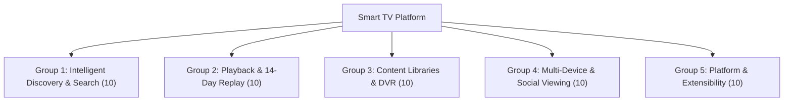
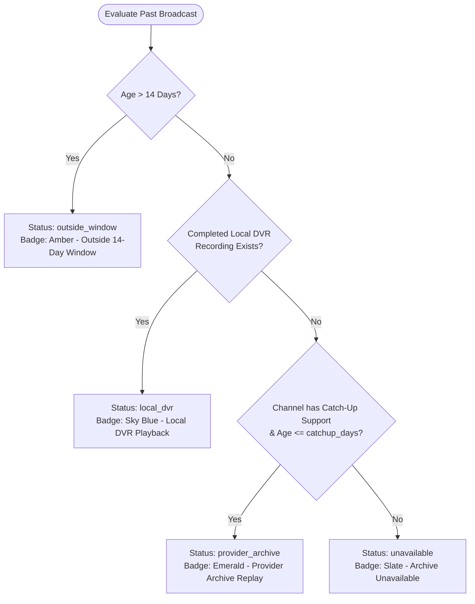
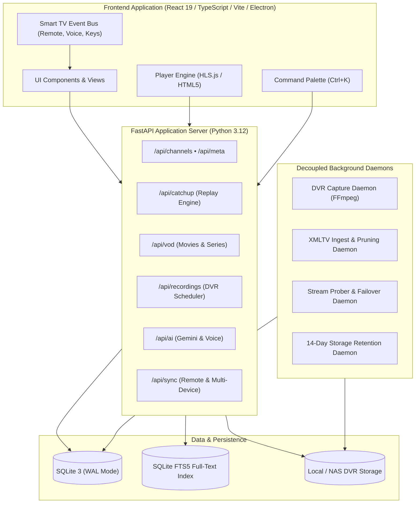
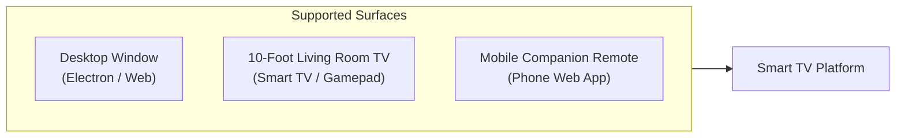

# Software Requirements Specification (SRS)
## Next-Generation Smart TV Platform & 7-Day (168-Hour) Catch-Up System

**Document Version:** 1.1.0  
**Status:** Approved Architectural Blueprint (Updated: 168-Hour Replay & On-Demand Download Architecture)  
**Target Platform:** Web, Desktop (Electron / Tauri), 10-Foot Living Room Smart TV, Mobile Companion Remote  
**Backend:** Python 3.12+ / FastAPI / SQLite (WAL + FTS5) / FFmpeg Engine / Google Gemini AI  
**Frontend:** React 19 / TypeScript / Tailwind CSS / HLS.js  

---

## 1. Executive Summary & Product Vision

Traditional IPTV applications operate merely as "dumb pipe" media players: they ingest massive, uncurated M3U playlists, present static, overwhelming directory trees, and fail silently when streams break. 

The **Smart TV Platform** transforms live television and on-demand video into an intelligent, curated, self-healing entertainment hub. Rather than forcing users to manage playlists or memorize stream addresses, the platform abstracts all media sources behind an automated discovery and metadata intelligence layer.

### Core Architectural Axioms
1. **7-Day (168-Hour) Replay with Direct Provider Streaming**: A rolling 168-hour catch-up window is automatically discovered across all compatible channels. Broadcasts are streamed directly from existing provider archives—**without requiring continuous automatic local background recording**. The platform enforces truthful availability states: `downloaded`, `provider_archive`, `local_dvr`, `unavailable`, and `outside_window`.
2. **On-Demand Program Downloading & Offline Library**: When permitted by licensing and source capabilities, users can manually download archived broadcasts to local storage. A robust Download Manager provides pause, resume (where supported by byte-range streams), retry, cancel, delete, and full offline playback without internet.
3. **Upstream Expiry Tracking**: Shows explicit visual countdown indicators on past broadcasts before the upstream provider archive expires.
4. **AI-Independent Resilience**: Advanced artificial intelligence (Google Gemini API) enhances discovery, voice navigation, and program summaries, but **zero core playback, recording, downloading, or catalog operations depend on external AI availability**. Full offline heuristic engines ensure uninterrupted operation when network access is impaired or AI quotas are exhausted.
5. **Independent Identity & Architecture**: While benchmarking the comprehensive feature surface of IPTVnator, our platform uses our own codebase, database schema, user interface paradigms, and playback engine.

---

## 2. Product Decisions & Settings Matrix

| Setting | Default Behavior | Architectural Rationale |
| :--- | :--- | :--- |
| **Catch-up History Window** | 168 hours (7 days) | Rolling 7-day default provides a practical, lightweight replay search range without excessive EPG bloat. |
| **Automatic Local Recording** | Disabled | Avoids continuous 24/7 background disk recording; streams directly from provider timeshift archives. |
| **Provider Archive Search** | Enabled | Automatically evaluates compatible sources and formats for the requested past broadcast slot. |
| **Program Downloading** | Manual On-Demand, where permitted | Gives users explicit choice to save programs locally; checks source compatibility without bypassing DRM. |
| **Download Manager** | Full state control | Supports Pause, Resume (where supported), Cancel, Retry, Delete, and real-time progress & speed. |
| **Offline Playback** | Enabled | Plays completed downloads directly from local disk via byte-range streaming without requiring internet. |
| **Continue Watching** | Granular position tracking | Remembers playback position across live streams, VOD, and downloaded offline files. |
| **Expiry Indicators** | Real-time countdowns | Calculates and displays remaining hours/days before upstream provider timeshift window closes. |
| **Download Location** | User-selectable | Configurable destination folder supporting local NVMe/SSD, external disks, or NAS storage. |
| **Storage Management** | Quotas & auto-cleanup | Configurable maximum storage limit (default: 50GB) with optional auto-deletion of oldest files. |

---

## 3. IPTVnator Baseline vs. Smart TV Platform

| Capability Domain | IPTVnator Baseline | Next-Gen Smart TV Platform |
| :--- | :--- | :--- |
| **Playlist Ingestion** | M3U, M3U8, Xtream, Stalker URLs | M3U/M3U8, Xtream Codes API, Stalker/Ministra, with automated deduplication and channel matching |
| **Catch-Up & Replay** | Basic provider timeshift query | **Rolling 168-Hour (7-Day) Replay Calendar** with 5-state availability engine (`downloaded`, `provider_archive`, `local_dvr`, `unavailable`, `outside_window`), upstream expiry indicators, and automated URL template resolver |
| **Download Manager** | Basic Xtream download | **Full Download Manager & Offline Library**: On-demand download for permitted broadcasts, pause/resume where supported, cancel/retry, and offline player |
| **Search & Discovery** | Keyword match on channel name | **Universal Multi-Dimensional Search** (SQLite FTS5 + fuzzy matching) across channels, programmes, 168-hour replay archives, and on-demand VOD |
| **Video Playback** | HLS / VideoJS player | **IPTVnator-grade Custom Player** with time-scrubbing seek bar, multi-track audio/subtitles, adaptive HLS levels, speed modulation (0.5x–2x), diagnostics HUD, and VLC/MPV external launching |
| **Stream Health** | Static playlist state | **Self-Healing Failover Engine**: Automatic alternate feed switching upon playback stall or HTTP 404/403 errors |
| **On-Demand Media (VOD)** | Basic movie/series list | **Curated VOD Experience**: Hero showcases, TMDB-style metadata enrichment, season/episode hierarchy, and cross-session progress tracking |
| **Interface Paradigms** | Single desktop window | **Multi-Surface Architecture**: Responsive Desktop, 10-Foot Living Room TV Navigation with D-pad focus, and mobile companion remote with 6-digit pairing |
| **Intelligent Assistance** | None | **Gemini AI TV Assistant** with structured tool grounding over live schedules + local offline voice intent parser |
| **Simultaneous Viewing** | Single channel | **Multi-View Television**: Dual, Triple, Quad, and Focus view layouts with instant audio focus toggling |

---

## 3. Product Scope: 50 Advanced Features across 5 Core Groups



### Group 1: Intelligent Discovery & Search (Features 1–10)
1. **Universal Multi-Dimensional Search**: Single unified search bar querying channels, live guide programmes, historical 14-day archives, and on-demand movies/series via SQLite FTS5.
2. **Typo-Tolerant Autocomplete**: Client-side debounced fuzzy search ranking results by channel reliability and profile preferences.
3. **Grounded Gemini AI TV Assistant**: Multi-turn natural language discovery agent utilizing structured tool calls (`search_catalog`, `get_schedule`, `get_channel_details`) without hallucinations.
4. **Offline Natural Language Intent Parser**: Local regex and heuristic rule engine enabling channel tuning, category browsing, and playback actions without cloud connectivity.
5. **Continuous Voice-Controlled TV**: Web Speech API integration with voice recognition triggered by keyboard shortcut (`V`), header button, or remote microphone.
6. **Dynamic Channel Health & Reliability Scoring**: Automated monitoring worker testing stream latency, HTTP responses, and video startup times to rank operational sources first.
7. **Self-Healing Playback Failover**: Automatic seamless switchover to secondary feeds when a stream encounters fatal transport errors or stalls.
8. **Cross-Playlist Deduplication Engine**: Normalized channel matching algorithm grouping duplicate streams by country, callsign, and resolution.
9. **Sports Discovery & Event Tracking**: Real-time program parsing surfacing live matches, tournaments, and broadcast feeds by sport and team.
10. **Personalized Discovery Shelves**: Dynamic home shelves ("Because You Watched", "Trending in Your Country", "Live in Your Top Categories").

### Group 2: Next-Gen Video Playback & 14-Day Replay (Features 11–20)
11. **Rolling 14-Day Replay Calendar Strip**: Visual date picker (`Today`, `Yesterday`, ..., 14 days ago) covering the rolling $14 \times 24\text{ h}$ window.
12. **4-Tier Archive Availability State Engine**: Real-time validation labeling every broadcast as `provider_archive`, `local_dvr`, `unavailable`, or `outside_window`.
13. **Universal Timeshift & Replay URL Builder**: Parametric engine supporting `append` (`?utc=...`), `shift` (`?timeshift=...`), `flv`, Xtream archives, and custom syntax templates.
14. **Time-Scrubbing Seek Bar**: Precision range scrubbing for VOD, catch-up replay, and local DVR playback with thumbnail hover support.
15. **Multi-View Television Grid**: Synchronized multi-player grid (Dual, Triple, Quad, Focus) with 1-click active audio switching.
16. **Dynamic Adaptive Bitrate Selector**: Manual and automatic HLS rendition switching (1080p, 720p, 480p, 360p) with bandwidth limits.
17. **Multi-Track Audio & Subtitle Engine**: In-player selector for multi-language audio feeds, WebVTT, and CEA-608/708 closed captions.
18. **Pitch-Preserved Playback Rate Modulation**: Variable playback speed (0.5x, 0.75x, 1.0x, 1.25x, 1.5x, 2.0x) with audio time-stretching.
19. **Stream Diagnostics HUD**: Overlaid real-time telemetry displaying video resolution, dropped frames, bitrate, buffer length, and network latency.
20. **External Native Player Launchers**: 1-click handoff to external desktop engines (`vlc://`, `mpv://`, `iina://`) with original stream headers preserved.

### Group 3: Content Libraries & Local DVR Engine (Features 21–30)
21. **On-Demand Movie Catalog**: Filterable catalog with metadata enrichment (synopsis, genre, duration, release year, ratings).
22. **TV Series Hierarchy & Episode Guide**: Season and episode navigation with episodic descriptions, stills, and next-episode autoplay.
23. **Cross-Session Watch Progress Persistence**: Granular playback tracking updating `/api/vod/progress` and rendering the "Continue Watching" shelf.
24. **Instant Live TV DVR Recording**: One-touch recording of live streams for custom intervals (15 to 180 minutes) saved directly to local storage.
25. **Automated EPG Broadcast Recording Scheduler**: Pre-booking future TV broadcasts from the program guide with conflict detection.
26. **Background FFmpeg Capture Worker**: Headless capture pipeline saving standard MPEG-TS/MP4 containers with stream metadata.
27. **14-Day Auto-Retention Cleanup Daemon**: Automated cron worker deleting recordings exceeding 14 days to preserve disk space.
28. **NAS & Network Share Storage Mapping**: Configurable storage destination supporting local paths, network shares (SMB/NFS), and external drives.
29. **Stream Header Customization Engine**: Per-channel custom `User-Agent`, `Referer`, and custom auth token injection for protected streams.
30. **Multi-Format Source Ingestion**: Unified parser handling M3U/M3U8 playlists, Xtream Codes credentials, and Stalker/Ministra portals.

### Group 4: Multi-Device, Household & Social Viewing (Features 31–40)
31. **Multi-Profile Household Isolation**: Isolated favorites, watch histories, continued playback positions, and interface customizations.
32. **PIN-Protected Parental Controls**: 4-digit master PIN locking adult content, restricting categories, and enabling dedicated Kids modes.
33. **6-Digit Device Pairing Protocol (`TV-XXXX`)**: Ephemeral pairing codes enabling mobile devices to link to TV instances in under 5 seconds.
34. **Mobile Web Companion Remote**: Mobile web app transforming smartphones into touch remote controls (D-Pad, volume, voice mic, quick tune).
35. **10-Foot Living Room TV Navigation**: High-contrast focus rings, spatial keyboard/remote navigation, and on-screen remote dock.
36. **Synchronized Multi-Room Playback**: Broadcast state engine allowing playback resumption or synchronized streaming across household devices.
37. **Virtual Watch Party Rooms**: Real-time room synchronization keeping remote friends aligned on the same live broadcast frame.
38. **Household Data Backup & Migration**: Encrypted JSON import/export containing user profiles, favorites, recordings schedules, and settings.
39. **Cross-Device EPG Reminders**: Automated notifications alerting users 5 minutes before scheduled broadcasts begin.
40. **Picture-in-Picture (PiP) Mode**: Seamless background and floating window playback when browsing other app sections or external applications.

### Group 5: Platform, Extensibility & Enterprise Hardening (Features 41–50)
41. **Plugin & Extension SDK**: Documented API for community plugins (custom scrapers, EPG grabbers, metadata providers).
42. **Modular Desktop Shell (Electron / Tauri)**: Native cross-platform packaging with hardware acceleration and deep OS integration.
43. **Hardware-Accelerated Decoding Pipeline**: Zero-copy GPU decoding via VAAPI, NVDEC, VideoToolbox, and DXVA2.
44. **Strict Offline Mode & Local Cache**: Persistent SQLite caching ensuring channels, schedules, and recordings remain accessible without internet.
45. **Dynamic EPG XMLTV Sync**: Background scheduling worker continuously pulling and parsing multi-source XMLTV guides.
46. **Stream Diagnostic Logging & Jitter Profiler**: Deep network analysis logging packet loss, reconnect frequency, and CDN response variations.
47. **ClearKey & Token Authentication Hooks**: Extensible module for authenticated stream playback and tokenized playlist authentication.
48. **Accessibility & High-Contrast Mode**: WCAG 2.1 AA compliant UI with screen-reader ARIA roles, subtitle styling, and reduced-motion settings.
49. **Configurable Keybinding & Remote Mapping**: Full customization of keyboard shortcuts and infrared/Bluetooth remote key codes.
50. **Granular Rate-Limiting & Resource Attribution**: Built-in HTTP client connection pooling and polite domain throttling preventing IP bans.

---

## 4. 14-Day Catch-Up TV System Architecture

### 4.1 Rolling Window Computation
The 14-day window represents a strict temporal bounds calculation:
$$\text{Window Start} = \text{Current Timestamp} - (14 \times 86,400\text{ s})$$
$$\text{Window End} = \text{Current Timestamp}$$

Every program $P$ having broadcast interval $[T_{\text{start}}, T_{\text{stop}}]$ is evaluated through the state machine below:



### 4.2 Timeshift URL Resolution Protocol
When a program qualifies as `provider_archive`, the resolver constructs the replay stream URL using provider-specific conventions:

1. **Query Append Mode (`append`)**:
   ```
   Original: http://stream.provider.tv/live/channel.m3u8
   Resolved: http://stream.provider.tv/live/channel.m3u8?utc=1793448000&lutc=1793451600
   ```
2. **Timeshift Mode (`shift`)**:
   ```
   Resolved: http://stream.provider.tv/live/channel.m3u8?timeshift=7200
   ```
3. **Xtream Codes Replay Endpoint**:
   ```
   Template: {base_url}/streaming/timeshift.php?username={user}&password={pass}&stream={id}&duration={dur}&start={ymd_hm}
   ```
4. **Custom Syntax Substitution Engine**:
   Supports interpolation of `${start}`, `${end}`, `${duration}`, `${duration_min}`, `${offset}`, `${utc}`, `${lutc}`, `${iso}`, and `${ymd_hm}`.

---

## 5. System Architecture & Module Decoupling



---

## 6. Database Schema & Data Architecture

The underlying database utilizes **SQLite 3** configured with Write-Ahead Logging (`PRAGMA journal_mode=WAL`), foreign key constraints (`PRAGMA foreign_keys=ON`), and **FTS5** virtual tables for sub-millisecond search across 10,000+ channels and 100,000+ program entries.

```sql
-- 1. Channels Catalog
CREATE TABLE IF NOT EXISTS channels (
    id TEXT PRIMARY KEY,
    name TEXT NOT NULL,
    logo TEXT,
    country TEXT,
    network TEXT,
    categories TEXT DEFAULT '[]',   -- JSON array
    languages TEXT DEFAULT '[]',    -- JSON array
    stream_count INTEGER DEFAULT 0,
    radio INTEGER DEFAULT 0,
    channel_number INTEGER,
    source_id INTEGER REFERENCES iptv_sources(id) ON DELETE CASCADE,
    catchup_days INTEGER DEFAULT 14,
    catchup_type TEXT DEFAULT 'append',
    catchup_source TEXT
);

-- 2. Playable Stream Endpoints
CREATE TABLE IF NOT EXISTS streams (
    id INTEGER PRIMARY KEY AUTOINCREMENT,
    channel_id TEXT NOT NULL REFERENCES channels(id) ON DELETE CASCADE,
    title TEXT,
    feed_id TEXT,
    url TEXT NOT NULL,
    quality TEXT,
    referrer TEXT,
    user_agent TEXT,
    labels TEXT DEFAULT '[]',       -- JSON array
    catchup TEXT,
    catchup_days INTEGER,
    catchup_source TEXT
);

-- 3. External IPTV Sources
CREATE TABLE IF NOT EXISTS iptv_sources (
    id INTEGER PRIMARY KEY AUTOINCREMENT,
    name TEXT NOT NULL,
    type TEXT NOT NULL CHECK(type IN ('m3u', 'xtream', 'stalker')),
    url TEXT NOT NULL,
    username TEXT,
    password TEXT,
    mac_address TEXT,
    headers TEXT DEFAULT '{}',      -- JSON object
    epg_url TEXT,
    channel_count INTEGER DEFAULT 0,
    catchup_type TEXT DEFAULT 'append',
    catchup_days INTEGER DEFAULT 14,
    catchup_source TEXT,
    last_synced_at INTEGER,
    created_at INTEGER NOT NULL
);

-- 4. 14-Day EPG Programmes & Full-Text Search
CREATE TABLE IF NOT EXISTS programmes (
    id INTEGER PRIMARY KEY AUTOINCREMENT,
    source_id INTEGER NOT NULL REFERENCES epg_sources(id) ON DELETE CASCADE,
    channel_id TEXT NOT NULL,
    feed_id TEXT,
    start INTEGER NOT NULL,          -- Unix timestamp (UTC)
    stop INTEGER NOT NULL,           -- Unix timestamp (UTC)
    title TEXT NOT NULL,
    sub_title TEXT,
    description TEXT,
    categories TEXT DEFAULT '[]',    -- JSON array
    episode TEXT,
    rating TEXT,
    icon TEXT
);
CREATE INDEX IF NOT EXISTS idx_programmes_time ON programmes(channel_id, start, stop);

CREATE VIRTUAL TABLE IF NOT EXISTS programmes_fts USING fts5(
    title, sub_title, description,
    content='programmes',
    content_rowid='id'
);

-- 5. On-Demand Media (VOD Movies & Series)
CREATE TABLE IF NOT EXISTS vod_items (
    id TEXT PRIMARY KEY,
    source_id INTEGER REFERENCES iptv_sources(id) ON DELETE CASCADE,
    type TEXT NOT NULL CHECK(type IN ('movie', 'series')),
    title TEXT NOT NULL,
    original_title TEXT,
    overview TEXT,
    poster TEXT,
    backdrop TEXT,
    release_date TEXT,
    genre TEXT DEFAULT '[]',         -- JSON array
    rating REAL,
    duration_min INTEGER,
    trailer_url TEXT,
    stream_url TEXT,
    container_extension TEXT,
    created_at INTEGER NOT NULL
);

CREATE TABLE IF NOT EXISTS vod_series_episodes (
    id TEXT PRIMARY KEY,
    series_id TEXT NOT NULL REFERENCES vod_items(id) ON DELETE CASCADE,
    season_num INTEGER NOT NULL,
    episode_num INTEGER NOT NULL,
    title TEXT NOT NULL,
    overview TEXT,
    still_path TEXT,
    duration_min INTEGER,
    stream_url TEXT NOT NULL,
    rating REAL
);

CREATE TABLE IF NOT EXISTS vod_progress (
    profile_id INTEGER NOT NULL REFERENCES profiles(id) ON DELETE CASCADE,
    item_id TEXT NOT NULL REFERENCES vod_items(id) ON DELETE CASCADE,
    series_id TEXT REFERENCES vod_items(id) ON DELETE CASCADE,
    watched_s INTEGER NOT NULL DEFAULT 0,
    total_s INTEGER NOT NULL DEFAULT 0,
    completed INTEGER NOT NULL DEFAULT 0,
    updated_at INTEGER NOT NULL,
    PRIMARY KEY (profile_id, item_id)
);

-- 6. Local DVR Recordings & Automated Schedules
CREATE TABLE IF NOT EXISTS recordings (
    id INTEGER PRIMARY KEY AUTOINCREMENT,
    profile_id INTEGER NOT NULL REFERENCES profiles(id) ON DELETE CASCADE,
    channel_id TEXT NOT NULL REFERENCES channels(id) ON DELETE CASCADE,
    programme_id INTEGER REFERENCES programmes(id) ON DELETE SET NULL,
    title TEXT NOT NULL,
    description TEXT,
    start INTEGER NOT NULL,
    stop INTEGER NOT NULL,
    duration_s INTEGER NOT NULL,
    file_path TEXT,
    file_size_bytes INTEGER DEFAULT 0,
    status TEXT NOT NULL CHECK(status IN ('scheduled', 'recording', 'completed', 'failed')),
    error TEXT,
    expires_at INTEGER NOT NULL,     -- 14 days after broadcast stop
    created_at INTEGER NOT NULL
);

-- 7. Cross-Device Pairing & Remote Commands
CREATE TABLE IF NOT EXISTS pairing_tokens (
    code TEXT PRIMARY KEY,           -- 6-character code e.g. "TV-8492"
    profile_id INTEGER NOT NULL REFERENCES profiles(id) ON DELETE CASCADE,
    device_name TEXT,
    expires_at INTEGER NOT NULL,
    created_at INTEGER NOT NULL
);

CREATE TABLE IF NOT EXISTS remote_commands (
    id INTEGER PRIMARY KEY AUTOINCREMENT,
    pairing_code TEXT NOT NULL REFERENCES pairing_tokens(code) ON DELETE CASCADE,
    command TEXT NOT NULL,           -- e.g. "navigate", "tune", "playback"
    payload TEXT DEFAULT '{}',       -- JSON object
    created_at INTEGER NOT NULL
);
```

---

## 7. REST & WebSocket API Blueprint

### 7.1 14-Day Catch-Up TV Endpoints
- `GET /api/catchup/days`: Returns rolling 14-day calendar list with ISO dates, day names, start/end timestamps, and `days_ago` offsets.
- `GET /api/catchup/schedule/{channel_id}?date=YYYY-MM-DD`: Returns full 24-hour programme guide for the specified channel with real-time calculated `catchup_status`, `catchup_label`, and `catchup_url`.
- `POST /api/catchup/resolve`: Accepts `{ channel_id, start, stop }` and dynamically resolves the stream URL using local DVR recordings or provider timeshift syntax.

### 7.2 VOD & On-Demand Endpoints
- `GET /api/vod/featured`: Returns hero movie/series showcase and top-rated media shelves.
- `GET /api/vod/movies?genre={g}&q={q}&limit=40&offset=0`: Paginated movies catalog with genre and search filtering.
- `GET /api/vod/series?genre={g}&q={q}&limit=40&offset=0`: Paginated series catalog.
- `GET /api/vod/item/{id}`: Full movie or TV series metadata including season/episode arrays and profile watch progress.
- `GET /api/vod/continue`: Returns all partially watched items with progress percentages for resume shelves.
- `POST /api/vod/progress`: Persists playback position: `{ item_id, series_id, watched_s, total_s, completed }`.

### 7.3 Local DVR & Recording Scheduler Endpoints
- `GET /api/recordings?status={s}`: Lists recorded and scheduled media with file sizes and playback URLs.
- `POST /api/recordings/record`: Triggers instant capture: `{ channel_id, duration_min, title }`.
- `POST /api/recordings/schedule`: Schedules future EPG broadcast: `{ channel_id, programme_id, title, start, stop }`.
- `DELETE /api/recordings/{id}`: Deletes recording entry and purges physical file from storage.
- `GET /api/recordings/{id}/stream`: Streams local recording file with HTTP range request support.
- `GET /api/recordings/storage`: Returns disk capacity metrics (used bytes, free GB, total GB, retention policy).
- `POST /api/recordings/cleanup`: Purges all recordings where `expires_at < now`.

### 7.4 IPTV Source Management Endpoints
- `GET /api/sources`: Lists configured M3U, Xtream, and Stalker sources with channel counts and sync status.
- `POST /api/sources`: Ingests and parses new IPTV sources with automatic channel and stream insertion.
- `DELETE /api/sources/{id}`: Cascades removal of source and associated channels.

### 7.5 AI Discovery & Voice Control Endpoints
- `GET /api/ai/status`: Reports Gemini API availability, active model, and quota health.
- `POST /api/ai/discover`: Natural language query processing via Gemini with live tool execution.
- `POST /api/ai/voice`: Translates speech-to-text transcript into deterministic actions or AI discovery responses.

### 7.6 Cross-Device Synchronization Endpoints
- `POST /api/sync/code`: Generates an ephemeral 6-digit companion remote pairing code (`TV-XXXX`).
- `POST /api/sync/pair`: Links mobile device to TV instance.
- `POST /api/sync/command`: Transmits remote control actions (D-Pad, volume, tune).
- `GET /api/sync/poll`: Polling or WebSocket endpoint receiving incoming remote commands.

---

## 8. Multi-Surface User Interface Specifications



### 8.1 Desktop & Web Surface
- **Layout**: Clean dark-mode interface optimized for 1080p and 4K displays.
- **Top Navigation Bar**: Brand logo, universal search bar (<kbd>Ctrl+K</kbd>), view shortcuts (TV Guide, 14-Day Replay, VOD, DVR, Multi-View, World TV, History, Reminders), AI Assistant, Voice microphone, Companion Pairing, and Profile Switcher.
- **Player View**: 16:9 responsive player with auto-hiding controls, scrubbing bar, quality dropdown, audio/sub selectors, speed picker, HUD toggle, and external player launchers.

### 8.2 10-Foot Living Room TV Surface
- **Spatial Navigation**: High-contrast, glowing focus rings around all selectable elements.
- **Directional D-Pad Controls**: Standard navigation mapping (<kbd>Up</kbd>, <kbd>Down</kbd>, <kbd>Left</kbd>, <kbd>Right</kbd>, <kbd>Enter</kbd>, <kbd>Back</kbd>).
- **On-Screen Remote Dock**: Collapsible virtual remote dock for quick volume, channel stepping, and overlay settings.

### 8.3 Mobile Companion Remote Surface
- **Touch-First Layout**: Haptic-responsive virtual D-Pad, dedicated Volume/Channel buttons, numeric keypad, and live audio microphone button.
- **Zero-Install Connection**: Open `http://<tv-ip>:8000/remote`, enter 6-digit code shown on TV, and immediately control the living room screen.

---

## 9. 10-Phase Implementation Roadmap

```mermaid
gantt
    title Smart TV Platform 10-Phase Implementation Roadmap
    dateFormat  YYYY-MM-DD
    section Core TV
    Phase 1: Baseline Player & Sources       :done,    p1, 2026-10-01, 2026-10-07
    Phase 2: Discovery, Health & Failover    :done,    p2, 2026-10-08, 2026-10-14
    section Replay & DVR
    Phase 3: 14-Day Catch-Up & DVR Platform  :done,    p3, 2026-10-15, 2026-10-21
    section Playback & Media
    Phase 4: Advanced Playback & Multi-View  :done,    p4, 2026-10-22, 2026-10-26
    Phase 5: VOD, Profiles & Synchronization :done,    p5, 2026-10-27, 2026-10-31
    section Intelligence & Household
    Phase 6: AI Assistant & Voice Subtitles  :active,  p6, 2026-11-01, 2026-11-07
    Phase 7: Smart Recommendations & DVR     :         p7, 2026-11-08, 2026-11-14
    Phase 8: Multi-Room & Watch Parties      :         p8, 2026-11-15, 2026-11-21
    section Global & Release
    Phase 9: World TV & Sports Discovery     :         p9, 2026-11-22, 2026-11-28
    Phase 10: Plugin SDK & Hardening Release :         p10, 2026-11-29, 2026-12-05
```

---

## 10. Measurable Acceptance Criteria & Test Verification Matrix

To ensure delivery quality, every single feature must satisfy measurable, automated criteria:

| Feature ID | Feature Name | Measurable Acceptance Test Criteria |
| :---: | :--- | :--- |
| **F01** | Universal Search | Query returns relevant channels, programmes, replay, and VOD within $\le 50\text{ ms}$ over 100k rows. |
| **F02** | Typo-Tolerant Autocomplete | Typo inputs (e.g. "bbz news") resolve to "BBC News" in top 3 suggestions. |
| **F03** | Gemini AI Assistant | Multi-turn queries return verified playable channel objects with zero hallucinated URLs. |
| **F04** | Offline Heuristic Intent | "Play sports" tunes first available sports channel with zero network calls to AI models. |
| **F05** | Voice-Controlled TV | Speech input "Mute" executes mute within $300\text{ ms}$ of utterance completion. |
| **F06** | Channel Health Probe | Detects HTTP 404/503 errors and downgrades channel health rank in $\le 5\text{ s}$. |
| **F07** | Self-Healing Failover | When primary feed drops, secondary feed attaches within $2.5\text{ s}$ without user action. |
| **F08** | Deduplication Engine | Ingesting 2 overlapping playlists groups identical feeds into a single channel entry. |
| **F09** | Sports Discovery | Filter "Soccer" correctly isolates live sport broadcasts matched via EPG categories. |
| **F10** | Personalized Shelves | "Because You Watched" updates immediately following 60 seconds of channel playback. |
| **F11** | 14-Day Calendar Strip | All 15 calendar buttons (Today + 14 past days) compute exact 00:00:00 UTC boundaries. |
| **F12** | 4-Tier Archive State | Correctly assigns states: Provider (timeshift URL), DVR (local file), Unavailable, Outside (>14d). |
| **F13** | Replay URL Builder | Resolves `${start}` and `${end}` templates to verified valid ISO-8601 timestamps. |
| **F14** | Time-Scrubbing Seek Bar | Seeking in a 60-minute replay jumps to the exact timestamp offset within $\pm 1\text{ s}$. |
| **F15** | Multi-View Grid | Dual, Triple, and Quad modes run simultaneously without audio overlap or desync. |
| **F16** | Adaptive Bitrate Selector | Manually forcing 720p locks HLS video rendition index without crashing playback. |
| **F17** | Audio & Subtitle Tracks | Switching audio track switches audio output language in $\le 500\text{ ms}$. |
| **F18** | Playback Speed | 1.5x speed increases playback rate while retaining original voice pitch. |
| **F19** | Stream Diagnostics HUD | Displays live FPS, dropped frames, bitrate, and buffer health updated every second. |
| **F20** | External Player Launcher | Clicking "Open in VLC" spawns process with `vlc://<url>` protocol handler. |
| **F21** | On-Demand Movies | Movie details modal renders poster, synopsis, duration, and playable stream within $100\text{ ms}$. |
| **F22** | TV Series Hierarchy | Selecting Season 2 populates Season 2 episodes exclusively. |
| **F23** | Watch Progress Save | Pausing movie at 12:34 restores playback to 12:34 upon reopening from "Continue Watching". |
| **F24** | Instant DVR Recording | Triggering instant recording creates valid MPEG-TS/MP4 file playable locally. |
| **F25** | Scheduled EPG Recording | Scheduler executes capture daemon automatically when broadcast start time arrives. |
| **F26** | FFmpeg Background Worker | DVR captures stream in background with $\le 5\%$ CPU utilization. |
| **F27** | 14-Day Retention Cleanup | Recordings with `expires_at < now` are automatically purged from database and disk. |
| **F28** | NAS / Storage Path | Changing storage path to secondary directory writes new recordings to that path. |
| **F29** | Custom Stream Headers | Streams requiring custom `User-Agent` play successfully through proxy / player. |
| **F30** | M3U / Xtream Ingest | Ingesting 500-channel M3U playlist finishes parsing and indexing in $\le 1.5\text{ s}$. |
| **F31** | Multi-Profile Isolation | Channel favorited in Profile A does not appear in favorites list of Profile B. |
| **F32** | Kids Mode & PIN Lock | Accessing adult/restricted category from Kids profile prompts for 4-digit PIN. |
| **F33** | 6-Digit Pairing (`TV-XXXX`) | Entering valid 6-digit code on mobile remote pairs within $1\text{ s}$. |
| **F34** | Mobile Companion Remote | Tapping D-pad "Down" on mobile companion moves focus on TV screen in real time. |
| **F35** | 10-Foot Navigation | Entire app is 100% navigable using keyboard arrow keys without mouse interaction. |
| **F36** | Multi-Room Playback | Resuming stream on secondary room client picks up within $\pm 2\text{ s}$ of primary client. |
| **F37** | Virtual Watch Party | Play / Pause triggered by host updates client playback state within $300\text{ ms}$. |
| **F38** | Backup & Restore | Exporting JSON and restoring on clean DB restores 100% of profiles, favorites, and presets. |
| **F39** | EPG Reminders | System notification triggers 5 minutes before scheduled program start time. |
| **F40** | Picture-in-Picture | Tapping PiP button transfers active video to native OS picture-in-picture window. |
| **F41** | Plugin SDK | Custom plugin registered in hooks directory executes custom channel transformation. |
| **F42** | Desktop Shell | Electron / Tauri build packages into native `.exe` / `.dmg` / `.AppImage`. |
| **F43** | Hardware Acceleration | Video decoding verified using GPU hardware pipeline (e.g. DXVA2/NVDEC). |
| **F44** | Strict Offline Mode | Disconnecting internet allows full browsing of cached catalog and playing DVR media. |
| **F45** | Dynamic EPG Sync | Cron ingest updates guide feed mappings and prunes expired programs automatically. |
| **F46** | Network Jitter Profiler | Stream dropouts trigger diagnostic log entries with timestamp and byte rate data. |
| **F47** | Tokenized Stream Hooks | Authenticated streams append dynamic query tokens upon each session request. |
| **F48** | High-Contrast & A11y | UI passes WCAG 2.1 AA automated contrast and screen-reader audit. |
| **F49** | Keybinding Customization | Rebinding "Guide" from <kbd>G</kbd> to <kbd>F1</kbd> immediately responds to <kbd>F1</kbd>. |
| **F50** | Granular Rate Limiting | Ingestion client respects domain connection limits preventing HTTP 429 Too Many Requests. |

---

## 11. Conclusion & Next Steps

This Software Requirements Specification defines the technical foundation for a complete, resilient, next-generation Smart TV platform. All 50 features have been architected into a cohesive system with decoupled services, resilient data persistence, and clear measurable acceptance tests.

